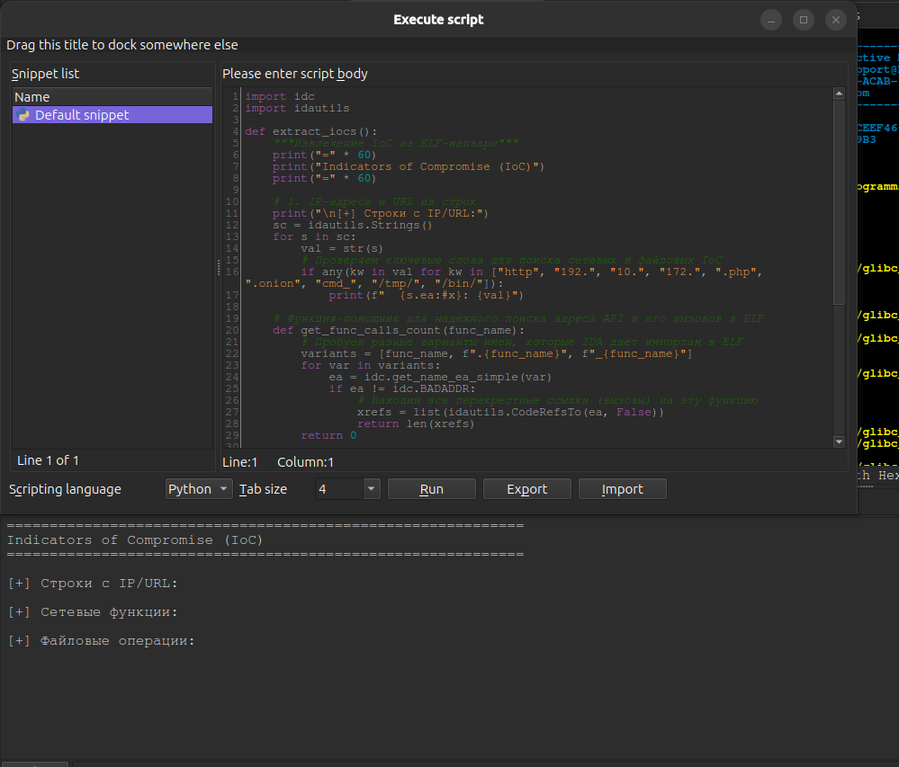
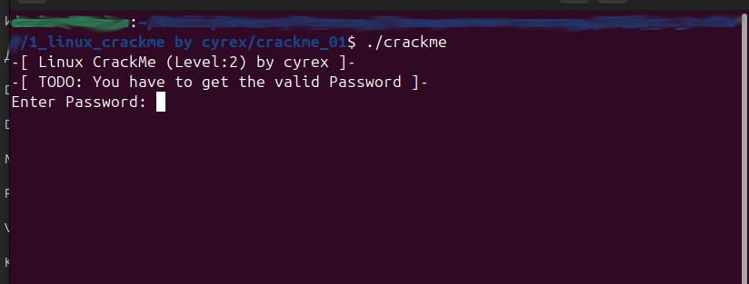
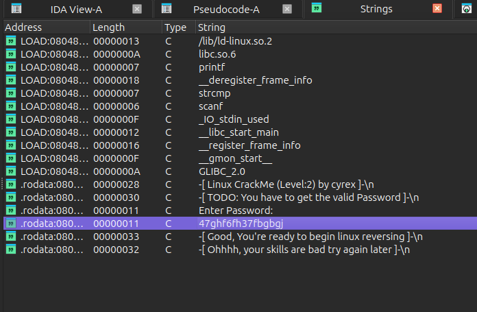
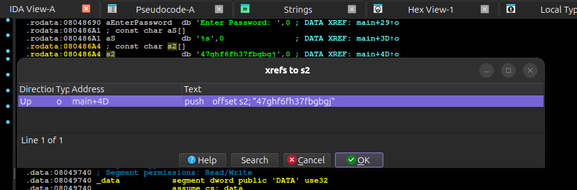
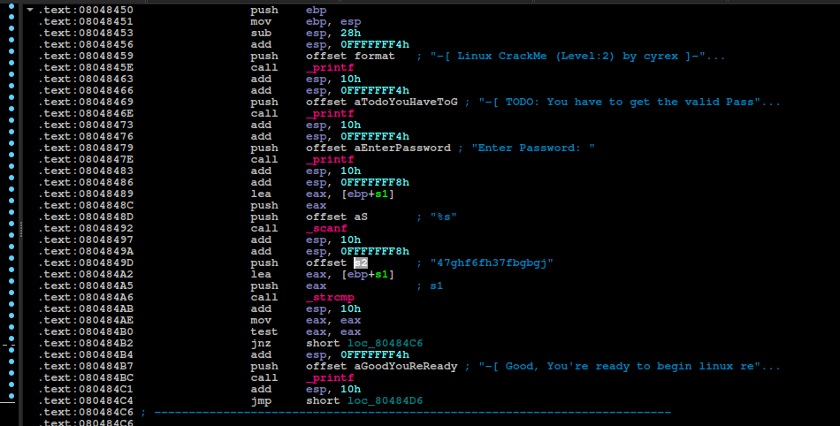
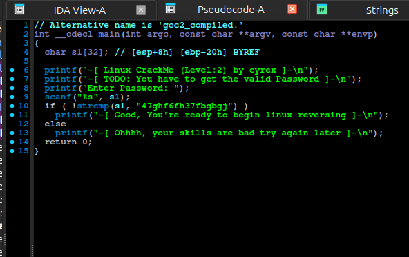
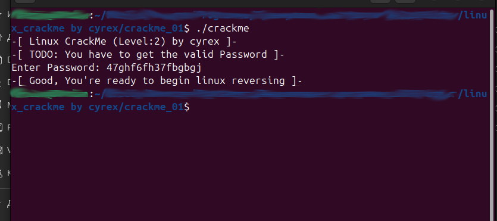

# Учебное пособие - linux_crackme by cyrex

## Analyst: Velana

## Host OS: Linux

## Tools Used:  IDA Pro (статический анализ)

### Информация об исследуемом файле

| Параметр | Значение |
| :--- | :--- |
| **Имя файла** | `linux_crackme` |
| **Архитектура / Формат** | ELF for Intel 386 (Executable)|
| **Компилятор** | GNU C++ |
| **SHA-256 хэш** | `5B769A608A0F98AAD7B7F9F7D6C0ACEEF466167FC0BCFE332BD9569F95DF4842` |
| **MD5 хэш** | `9413438BC023926B4780EBB47AB289B3` |

---

### Цель исследования

Анализ исполняемого файла с целью поиска ключа для успешной валидации. Исходные инструкции от автора отсутствовали.

## Исследование

1. **Первичный анализ**: Исполняемый файл был загружен в Linux-версию IDA Pro. Для автоматизации сбора базовых индикаторов компрометации (IoC) был применен скрипт на IDAPython. По результатам его выполнения в консоли Output (см. рис.1) не зафиксировано явных файловых операций, сетевых вызовов или жестко закодированных сетевых путей. Данный результат свидетельствует об отсутствии базовых механизмов сетевой активности и сложных деструктивных функций работы с ОС в анализируемом crackme.

```python
import idc
import idautils

def extract_iocs():
    """Извлечение IoC из ELF-малвари"""
    print("=" * 60)
    print("Indicators of Compromise (IoC)")
    print("=" * 60)

    # 1. IP-адреса и URL из строк
    print("\n[+] Строки с IP/URL:")
    sc = idautils.Strings()
    for s in sc:
        val = str(s)
        if any(kw in val for kw in ["http", "192.", "10.", "172.", ".php", ".onion", "cmd_", "/tmp/", "/bin/"]):
            print(f"  {s.ea:#x}: {val}")

    # Функция-помощник для надежного поиска адреса API и его вызовов в ELF
    def get_func_calls_count(func_name):
        variants = [func_name, f".{func_name}", f"_{func_name}"]
        for var in variants:
            ea = idc.get_name_ea_simple(var)
            if ea != idc.BADADDR:
                xrefs = list(idautils.CodeRefsTo(ea, False))
                return len(xrefs)
        return 0

    # 2. Используемые сетевые функции
    print("\n[+] Сетевые функции:")
    net_funcs = ["socket", "connect", "bind", "listen", "accept", "send", "recv", "sendto", "recvfrom", "inet_addr"]
    for name in net_funcs:
        calls = get_func_calls_count(name)
        if calls > 0:
            print(f"  {name}: {calls} вызов(ов)")

    # 3. Файловые операции
    print("\n[+] Файловые операции:")
    file_funcs = ["fopen", "open", "fwrite", "write", "unlink", "rename"]
    for name in file_funcs:
        calls = get_func_calls_count(name)
        if calls > 0:
            print(f"  {name}: {calls} вызов(ов)")

extract_iocs()
```



*Рис.1. Результат работы скрипта*

Запуск программы для анализа ее базового поведения показал, что на начальном этапе выполнения выводится запрос пароля.



*Рис.2. Запуск программы в терминале*

Для проведения первичного статического анализа в среде IDA Pro было открыто окно генерируемых строк (Strings) с целью поиска текстовых артефактов. Из немногочисленных строк была замечена строка "47ghf6fh37fbgbgj", вероятно загаданный пароль, по адресу .rodata:080486A4.



*Рис.3. Доступные строки*

Использование перекрестных ссылок (XREFs) к адресу жестко закодированного ключа "47ghf6fh37fbgbgj" позволило определить точку его использования в процедуре валидации внутри функции main.



*Рис.4. Перекрестные ссылки для строки*



*Рис.5. Функция в дизассемблере*

2. **Анализ логики валидации (Декомпиляция)**: После переключения в окно встроенного декомпилятора (Pseudocode) была проанализирована логика валидации, основанная на сравнении введенных пользователем данных с константной строкой s2.



*Рис.6. Функция в декомпиляторе*

Таким образом, жестко закодированная строка "47ghf6fh37fbgbgj" является искомым ключом активации. Для верификации полученного результата был выполнен запуск исполняемого файла с передачей найденного значения.



*Рис.7. Результат работы программы*

## Результат

При вводе найденной строки программа успешно отработала и вывела на экран финальное поздравительное сообщение: "Good, You're ready to begin linux reversing".
Поставленная задача полностью решена. Логика валидации была успешно реконструирована исключительно методами статического анализа.

## Статус: Crackme успешно решен (Cracked)
